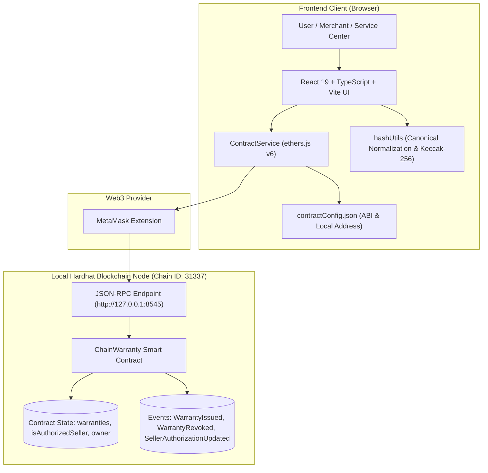
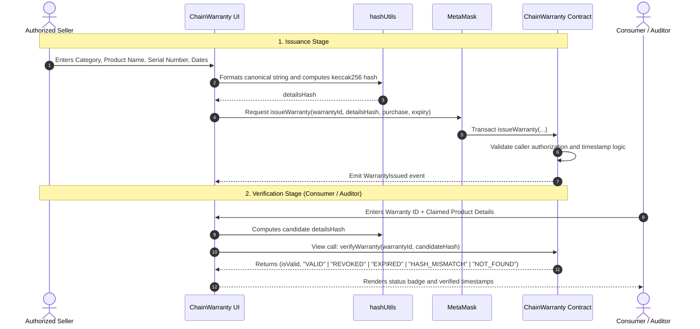

# ChainWarranty — Blockchain-Based Digital Warranty Card System


> A decentralized digital warranty management prototype built using Solidity, Hardhat, React, TypeScript, and ethers.js. Authorized sellers issue digital warranty cards, records are immutably verified via cryptographic hashes, and warranties can be audited, listed, or revoked according to smart contract policy.

---

## Table of Contents

- [1. Project Overview](#1-project-overview)
- [2. Problem Statement](#2-problem-statement)
- [3. Proposed Solution](#3-proposed-solution)
- [4. Key Features](#4-key-features)
- [5. Technology Stack](#5-technology-stack)
- [6. Architecture Overview](#6-architecture-overview)
- [7. System Workflow](#7-system-workflow)
- [8. Smart Contract Functionality](#8-smart-contract-functionality)
- [9. Cryptographic Hashing and Verification](#9-cryptographic-hashing-and-verification)
- [10. Security and Privacy Considerations](#10-security-and-privacy-considerations)
- [11. Project Directory Structure](#11-project-directory-structure)
- [12. Prerequisites](#12-prerequisites)
- [13. Installation and Setup](#13-installation-and-setup)
- [14. Starting a Local Hardhat Node](#14-starting-a-local-hardhat-node)
- [15. Deploying the Contract Locally](#15-deploying-the-contract-locally)
- [16. Authorizing a Seller Account](#16-authorizing-a-seller-account)
- [17. Starting the Frontend](#17-starting-the-frontend)
- [18. Connecting MetaMask to Hardhat Local](#18-connecting-metamask-to-hardhat-local)
- [19. End-to-End Application Usage](#19-end-to-end-application-usage)
- [20. Running Automated Tests](#20-running-automated-tests)
- [21. Building the Frontend for Production](#21-building-the-frontend-for-production)
- [22. Troubleshooting Common Issues](#22-troubleshooting-common-issues)
- [23. Known Limitations](#23-known-limitations)
- [24. Future Improvements](#24-future-improvements)
- [25. Verified Test and Build Results](#25-verified-test-and-build-results)
- [26. Disclaimer](#26-disclaimer)
- [27. License](#27-license)

---

## 1. Project Overview

**ChainWarranty** is an end-to-end decentralized application (dApp) designed to demonstrate how blockchain technology and cryptographic hashing solve common issues in physical warranty administration.

The system allows brand owners to authorize merchant addresses. Authorized merchants issue digital warranty cards directly onto an Ethereum-compatible blockchain. Consumers and service centers can query and verify the authenticity of a warranty card in real time without trusting an intermediary or exposing customer personally identifiable information (PII).

> [!IMPORTANT]
> **Environment Status**: ChainWarranty has been developed and comprehensively tested on a **local Hardhat blockchain environment** (Chain ID: `31337`). It has **NOT** been deployed to Sepolia testnet or the Ethereum mainnet.

---

## 2. Problem Statement

Traditional consumer product warranty systems suffer from several persistent shortcomings:

1. **Loss and Degradation of Paper Cards**: Physical warranty receipts and paper slips fade, get lost, or are difficult to locate when needed years later.
2. **Warranty Fraud and Counterfeiting**: Paper certificates and basic digital PDFs are easily fabricated or altered using basic image editing tools.
3. **Siloed Merchant Databases**: Centralized brand warranty portals lack interoperability, meaning secondary buyers or third-party repair centers cannot independently confirm warranty validity.
4. **Customer Privacy Risks**: Centralized warranty registration often forces consumers to hand over personal contact details to centralized databases vulnerable to leaks and spam.

---

## 3. Proposed Solution

ChainWarranty replaces paper cards and centralized databases with a decentralized smart contract architecture:

- **Immutable On-Chain Registry**: Warranty issuance records and revocation statuses are recorded immutably on the blockchain.
- **Cryptographic Fingerprinting**: Product metadata (category, product model, serial number) is normalized and hashed off-chain using Keccak-256 before being stored. Only the resulting `detailsHash` is kept on-chain.
- **Permissioned Issuance**: Only merchant accounts explicitly authorized by the contract owner can issue warranty cards.
- **Instant Decentralized Verification**: Anyone can verify whether product metadata matches the original issued card and inspect current validity (`VALID`, `EXPIRED`, `REVOKED`, `HASH_MISMATCH`, or `NOT_FOUND`) with zero gas cost via free smart contract view calls.

---

## 4. Key Features

- **Decentralized Wallet Integration**: Connects seamlessly with MetaMask via ethers.js v6 with automatic network mismatch detection.
- **Role-Based Access Control**: Strict access boundaries separating Contract Owner operations from Authorized Seller actions.
- **Privacy-Preserving Verification**: Validates claims without ever storing sensitive customer data or plaintext serial numbers on public state.
- **Canonical Hash Normalization**: Case-insensitive and whitespace-trimmed parameter serialization eliminates accidental mismatch errors while preventing delimiter injection attacks.
- **Event-Driven Warranty History**: Frontend dynamically queries and indexes contract events (`WarrantyIssued`, `WarrantyRevoked`) to build a historical record view without relying on centralized indexing servers.
- **Lifecycle Status Inspection**: Instantly detects and displays active, expired, or voided/revoked warranty states.
- **Cryptographically Secure ID Generation**: Client generates collision-resistant 32-byte warranty IDs using `window.crypto.getRandomValues`.

---

## 5. Technology Stack

| Layer | Technologies | Purpose |
| :--- | :--- | :--- |
| **Smart Contract** | Solidity `0.8.20` | Core warranty storage, authorization logic, and verification functions |
| **Blockchain Dev** | Hardhat `^2.29.1`, Hardhat Toolbox | Local blockchain node, compilation, deployment scripts, and automated test suite |
| **Frontend Framework** | React `19.2`, TypeScript `~6.0`, Vite `^8.3` | Fast, reactive web client with strict type safety |
| **Styling & UI** | Tailwind CSS `v4`, Lucide React | Modern responsive interface, clear status indicators, and alerts |
| **Web3 Client** | ethers.js `^6.17.0` | BrowserProvider, signer management, contract calls, and event log filtering |
| **Testing** | Mocha, Chai, Hardhat Network | 44 automated unit and integration tests covering contract invariants and frontend utilities |

---

## 6. Architecture Overview



*For in-depth sequence flows and technical details, see [`docs/architecture.md`](file:///D:/Projects/ChainWarranty/docs/architecture.md).*

---

## 7. System Workflow



---

## 8. Smart Contract Functionality

The primary contract [`contracts/ChainWarranty.sol`](file:///D:/Projects/ChainWarranty/contracts/ChainWarranty.sol) exposes the following interfaces:

### Administrative & Authorization Controls
- **`owner`**: Public address of the contract deployer.
- **`isAuthorizedSeller(address seller)`**: Returns boolean status indicating whether an address has permission to mint warranty records.
- **`authorizeSeller(address seller)`**: Restricts seller addition strictly to the owner (`onlyOwner`).
- **`removeSeller(address seller)`**: Revokes a merchant's authorization (`onlyOwner`).

### Warranty Management
- **`issueWarranty(bytes32 _warrantyId, bytes32 _detailsHash, uint256 _purchaseTime, uint256 _expiryTime)`**: Mints a new warranty record. Restricted to `onlyAuthorizedSeller`. Validates that the ID is non-zero, unique, and that `expiryTime > purchaseTime`.
- **`revokeWarranty(bytes32 _warrantyId, string calldata _reason)`**: Invalids a warranty. Can only be invoked by either the **contract owner** or the **specific seller who issued that warranty**.

### Public Verification & Inspection (Gas-Free View Calls)
- **`getWarranty(bytes32 _warrantyId)`**: Returns the complete raw `WarrantyRecord` struct tuple.
- **`exists(bytes32 _warrantyId)`**: Checks whether a given warranty ID is registered on-chain.
- **`checkDetailsMatch(bytes32 _warrantyId, bytes32 _candidateHash)`**: Compares a claimed hash against the stored on-chain hash.
- **`isExpired(bytes32 _warrantyId)`**: Checks whether `block.timestamp >= expiryTime`.
- **`isRevoked(bytes32 _warrantyId)`**: Checks whether `record.isRevoked == true`.
- **`verifyWarranty(bytes32 _warrantyId, bytes32 _candidateHash)`**: Returns `(bool isValid, string memory statusString)` evaluating all checks in one unified call.

---

## 9. Cryptographic Hashing and Verification

To prevent inconsistencies across different platforms and user inputs, ChainWarranty implements a deterministic normalization standard in [`frontend/src/utils/hashUtils.ts`](file:///D:/Projects/ChainWarranty/frontend/src/utils/hashUtils.ts):

### 1. Canonical Serialization
1. Each field (Category, Product Name, Serial Number) is trimmed of leading and trailing whitespace.
2. All characters are converted to lowercase.
3. The delimiter pipe (`|`) is forbidden within field values to prevent boundary spoofing.
4. Fields are serialized in strict deterministic order:
   ```text
   category:<normalized_category>|product:<normalized_product>|serial:<normalized_serial>
   ```

### 2. Cryptographic Fingerprint
The normalized UTF-8 string is passed through `keccak256`:
```typescript
const detailsHash = keccak256(toUtf8Bytes(canonicalString));
```

### 3. Verification Guarantee
When a consumer presents a product for warranty claim:
- The serial number and product name are normalized using the exact same rule.
- If even a single character differs, the resulting hash will not match the on-chain hash, returning `HASH_MISMATCH`.

---

## 10. Security and Privacy Considerations

- **No On-Chain PII**: Customer names, addresses, invoice amounts, and raw serial numbers are never broadcasted to the blockchain.
- **Tamper Evidence**: Because blockchain state is immutable, once a warranty is registered, its purchase and expiration timestamps cannot be backdated or modified by any party.
- **Scoped Revocation Privileges**: Arbitrary authorized sellers cannot revoke warranties issued by competitor merchants. Only the original issuer or the contract administrator can revoke a warranty.
- **Limitation on Physical Authenticity**: Cryptographic hash matching proves that the entered product details match the record created by an authorized seller. It guarantees digital integrity, but cannot independently verify whether a physical item is authentic or counterfeit without a physical tamper-resistant identifier (e.g., cryptographic secure element NFC).

---

## 11. Project Directory Structure

```text
ChainWarranty/
├── contracts/
│   └── ChainWarranty.sol               # Core Solidity smart contract
├── scripts/
│   └── deploy.js                       # Deployment script & frontend config synchronizer
├── test/
│   ├── ChainWarranty.test.js           # Smart contract test suite (34 tests)
│   └── FrontendUtils.test.js           # Frontend hash & utility test suite (10 tests)
├── frontend/
│   ├── public/                         # Public assets (favicon, icons)
│   ├── src/
│   │   ├── assets/                     # UI graphics & logos
│   │   ├── components/                 # Reusable React components (Navbar, Sidebar, etc.)
│   │   ├── constants/                  # Application constants
│   │   ├── context/                    # React Context providers
│   │   ├── contracts/
│   │   │   └── contractConfig.json     # ABI and active local contract deployment address
│   │   ├── hooks/
│   │   │   └── useWallet.ts            # MetaMask connection and state hook
│   │   ├── pages/
│   │   │   ├── DashboardPage.tsx       # System overview & metrics
│   │   │   ├── IssueWarrantyPage.tsx   # Authorized seller warranty issuance form
│   │   │   ├── VerifyWarrantyPage.tsx  # Public verification & status checker
│   │   │   └── WarrantyListPage.tsx    # Event-driven warranty record list & revocation modal
│   │   ├── services/
│   │   │   └── contractService.ts      # Ethers.js v6 abstraction & pre-flight error handling
│   │   ├── types/
│   │   │   └── index.ts                # TypeScript interfaces and status types
│   │   ├── utils/
│   │   │   ├── dateUtils.ts            # Date formatting utilities
│   │   │   ├── hashUtils.ts            # Canonical normalization & Keccak-256 helpers
│   │   │   └── index.ts                # Utilities export hub
│   │   ├── App.tsx                     # Main layout and tab routing
│   │   ├── index.css                   # Tailwind CSS style definitions
│   │   └── main.tsx                    # React application entrypoint
│   ├── index.html                      # HTML root
│   ├── package.json                    # Frontend package dependencies & scripts
│   ├── tsconfig.json                   # TypeScript configuration
│   └── vite.config.ts                  # Vite build configuration
├── docs/
│   ├── architecture.md                 # Detailed architecture & sequence diagrams
│   └── screenshots/                    # Project screenshot guidelines & assets
├── .env.example                        # Safe environment template (placeholders only)
├── .gitignore                          # Git ignore rules for contracts and frontend
├── hardhat.config.js                   # Hardhat configuration (Solidity 0.8.20)
├── package.json                        # Root npm configuration (Hardhat tooling)
└── README.md                           # Project documentation
```

---

## 12. Prerequisites

Before running the project locally, ensure you have installed:

- **Node.js**: v18.0.0 or higher (v20+ LTS recommended)
- **npm**: v9.0.0 or higher
- **MetaMask**: Browser extension installed in your web browser (Chrome, Brave, Edge, or Firefox)
- **Git**: Installed for version control

---

## 13. Installation and Setup

Clone the repository and install dependencies in both the root project and frontend folders:

```bash
# Clone the repository
git clone https://github.com/<your-username>/ChainWarranty.git
cd ChainWarranty

# 1. Install root dependencies (Hardhat and testing tools)
npm install

# 2. Install frontend dependencies
cd frontend
npm install
cd ..
```

---

## 14. Starting a Local Hardhat Node

Hardhat provides an in-memory blockchain node pre-funded with 20 test accounts (each with 10,000 test ETH).

Open **Terminal 1** in the root directory:

```bash
npx hardhat node
```

> [!WARNING]
> Keep this terminal window running. The Hardhat blockchain operates entirely in-memory. If you stop the node, the blockchain state resets to block 0, and you will need to redeploy the contract.

---

## 15. Deploying the Contract Locally

Open **Terminal 2** in the root directory:

```bash
npm run deploy:local
```

### What this script does:
1. Connects to `localhost` (Chain ID `31337`).
2. Deploys `ChainWarranty.sol` using Account #0 (`0xf39Fd6e51aad88F6F4ce6aB8827279cffFb92266`).
3. Automatically reads the compiled ABI from `artifacts/` and writes the deployment address and ABI directly to `frontend/src/contracts/contractConfig.json`.

---

## 16. Authorizing a Seller Account

By default, the smart contract does not authorize any seller accounts. Only the deployer (Account #0) can authorize sellers.

To authorize Account #1 as a seller, you can run a quick Hardhat console command in **Terminal 2**:

```bash
npx hardhat console --network localhost
```

Inside the console, run:
```javascript
const contract = await ethers.getContractAt("ChainWarranty", "0x5FbDB2315678afecb367f032d93F642f64180aa3");
const accounts = await ethers.getSigners();
// Authorize Account #1 (0x70997970C51812dc3A010C7d01b50e0d17dc79C8)
await contract.authorizeSeller(accounts[1].address);
console.log("Seller authorized:", await contract.isAuthorizedSeller(accounts[1].address));
.exit
```

---

## 17. Starting the Frontend

In **Terminal 2**, navigate to the frontend directory and start the Vite development server:

```bash
cd frontend
npm run dev
```

Open your browser and navigate to `http://localhost:5173`.

---

## 18. Connecting MetaMask to Hardhat Local

To interact with the local blockchain through the browser:

### Step 1: Add the Hardhat Local Network to MetaMask
1. Open the MetaMask extension and click the network dropdown.
2. Select **Add Network** > **Add a network manually**.
3. Fill in the network parameters:
   - **Network Name**: `Hardhat Local`
   - **New RPC URL**: `http://127.0.0.1:8545`
   - **Chain ID**: `31337`
   - **Currency Symbol**: `ETH`
4. Click **Save** and switch to `Hardhat Local`.

### Step 2: Import Hardhat Test Accounts
Import the private keys from Terminal 1 for testing:
- **Deployer / Owner (Account #0)**: `0xac0974bec39a17e36ba4a6b4d238ff944bacb478cbed5efcae784d7bf4f2ff80`
- **Authorized Seller (Account #1)**: `0x59c6995e998f97a5a0044966f0945389dc9e86dae88c7a8412f4603b6b78690d`

> [!CAUTION]
> These private keys are public default Hardhat test keys. Never send real funds to these addresses and never use these keys on any public network.

---

## 19. End-to-End Application Usage

### 1. Dashboard Overview
Navigate to the **Dashboard** tab. When connected, the UI shows:
- Connection status and current active wallet address.
- Active network and Chain ID (`31337`).
- Total warranties and active status counters.

### 2. Issuing a Digital Warranty
1. Switch MetaMask to the authorized seller account (Account #1).
2. Navigate to **Issue Warranty**.
3. Enter the product details:
   - **Category**: e.g., `Electronics`
   - **Product Name**: e.g., `MacBook Pro 16`
   - **Serial Number**: e.g., `SN-MBP-98721-XYZ`
   - **Purchase Date**: Pick today's date.
   - **Expiry Date**: Pick a future date (e.g., 2 years ahead).
4. Click **Generate ID & Issue Warranty**.
5. Confirm the transaction in MetaMask.
6. The transaction confirms, and the unique `Warranty ID` and `Details Hash` are displayed.

### 3. Verifying a Warranty Card
1. Navigate to **Verify Warranty**.
2. Paste the **Warranty ID** generated during issuance.
3. Enter the exact matching product category, product name, and serial number.
4. Click **Verify Warranty**.
5. The application will query the smart contract and display a green **VALID** banner with verified purchase and expiry timestamps.
6. *Try testing a mismatch*: Change the serial number by 1 character. The verification will immediately return **HASH_MISMATCH**.

### 4. Warranty List & Revocation
1. Navigate to **Warranty Records**.
2. The table loads all warranties registered from smart contract event logs.
3. As the issuing seller or the contract owner, click **Revoke** on any record.
4. Enter a revocation reason (e.g., "Product returned and refunded").
5. Confirm the transaction in MetaMask.
6. Return to **Verify Warranty** and re-verify the Warranty ID. The status will now read **REVOKED**.

---

## 20. Running Automated Tests

ChainWarranty includes a comprehensive 44-test automated suite covering contract logic, edge cases, permissions, and frontend cryptographic utilities:

```bash
# Run the complete test suite from the root directory
npm test
```

### Verified Test Breakdown:
- **Ownership & Initialization**: Deployer assignment, initial state checks.
- **Seller Authorization**: Granting and revoking roles, non-owner rejection, zero address rejection, duplicate prevention.
- **Warranty Issuance**: Successful issuance, event emission, unauthorized mint rejection, zero ID/hash rejection, chronological timestamp checks.
- **Record Retrieval & Hashes**: Accurate struct field retrieval, hash matching checks.
- **Expiration Behavior**: Active vs. expired state evaluation.
- **Revocation Policy**: Owner and seller revocation privileges, unauthorized caller rejection, double revocation prevention.
- **Unified Verification**: Tests for all 5 status outcomes (`VALID`, `REVOKED`, `EXPIRED`, `HASH_MISMATCH`, `NOT_FOUND`).
- **Frontend Utilities**: Canonical formatting, boundary delimiter protection, bytes32 validation, timestamp conversion, and MetaMask error code parsing.

**Result: 44 passing tests (3s).**

---

## 21. Building the Frontend for Production

To produce an optimized production bundle of the React frontend:

```bash
cd frontend
npm run build
```

The output bundle will be compiled into `frontend/dist/`.

> [!NOTE]
> During the build, Vite flags a non-blocking chunk warning (`(!) Some chunks are larger than 500 kB after minification`) due to the bundled ethers.js library. This is normal for single-chunk development bundles and does not prevent deployment. Code splitting can be configured for future multi-page releases.

---

## 22. Troubleshooting Common Issues

### 1. `Wrong network detected (Chain ID: ...)`
- **Cause**: MetaMask is connected to Ethereum Mainnet, Sepolia, or another network.
- **Fix**: Switch MetaMask to your custom `Hardhat Local` network (Chain ID `31337`).

### 2. `Nonce too high` or `Transaction RPC error`
- **Cause**: The local Hardhat node was restarted, resetting the blockchain nonce to 0 while MetaMask still cached previous transaction counts.
- **Fix**: In MetaMask, go to **Settings** > **Advanced** > **Clear activity tab data** (or Reset Account).

### 3. `Action rejected: Your connected wallet is not an authorized seller`
- **Cause**: The active MetaMask account has not been authorized by the contract owner.
- **Fix**: Switch to the contract owner account (Account #0) and authorize the seller address (see [Authorizing a Seller Account](#16-authorizing-a-seller-account)).

### 4. `No contract found at address 0x5FbD...`
- **Cause**: The contract was not redeployed after restarting the Hardhat node.
- **Fix**: Run `npm run deploy:local` in your root terminal.

---

## 23. Known Limitations

- **Local Network Scope**: The prototype is configured and tested for a local Hardhat node. It has not been deployed to a public Ethereum testnet (such as Sepolia) or mainnet.
- **Ephemeral Node State**: Stopping `npx hardhat node` erases all in-memory transaction and warranty data.
- **Off-Chain Physical Verification**: Hash matching validates digital authenticity, but cannot guarantee that a physical product is genuine without hardware-based cryptographic identifiers.

---

## 24. Future Improvements

1. **Sepolia Testnet Deployment**: Add Hardhat network profiles and deploy to the public Sepolia testnet with verified Etherscan contracts.
2. **QR Code Generation**: Add QR code generation to the frontend so consumers can scan their warranty cards directly from mobile devices.
3. **Decentralized Storage (IPFS / Filecoin)**: Allow sellers to attach encrypted PDF invoices or product images stored on IPFS.
4. **Physical Tag Integration**: Pair warranty IDs with NFC cryptographic tags (e.g., NTAG 424 DNA) embedded into high-value products to link physical goods to on-chain records.
5. **Code Splitting**: Optimize frontend bundle chunking for ethers.js using dynamic imports.

---

## 25. Verified Test and Build Results

- **Automated Tests**:
  ```text
  ChainWarranty Smart Contract Test Suite: 34 passing
  Frontend Utilities & Integration Logic Tests: 10 passing
  Total: 44 passing (3s)
  ```
- **Production Build**:
  ```text
  ✓ built in 1.18s
  dist/index.html                   0.45 kB
  dist/assets/index-BHkE4fUb.css   35.83 kB
  dist/assets/index-DHNjbfD1.js   553.33 kB
  ```

---

## 26. Disclaimer

This software is an educational prototype developed for college project demonstration, technical evaluation, and portfolio purposes. It has not undergone an independent third-party smart contract security audit and should not be used in financial production environments or to secure live commercial assets without auditing.

---

## 27. License

The smart contract code in this repository includes the `SPDX-License-Identifier: MIT` header. The repository author should choose and attach the definitive open-source license file (e.g., MIT License) upon public release.
