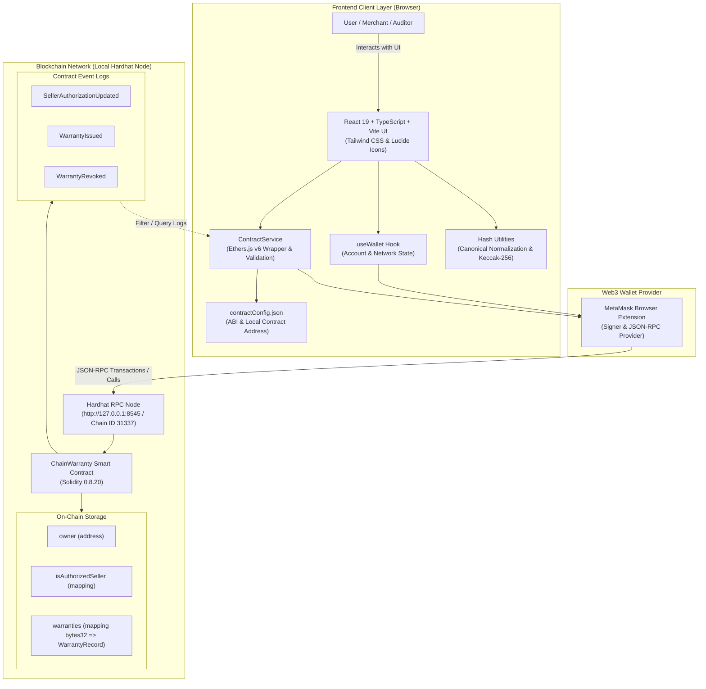
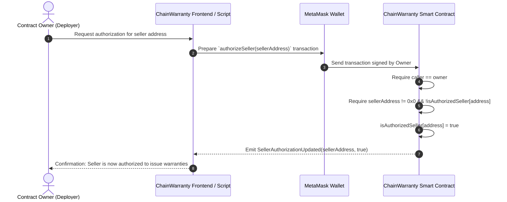
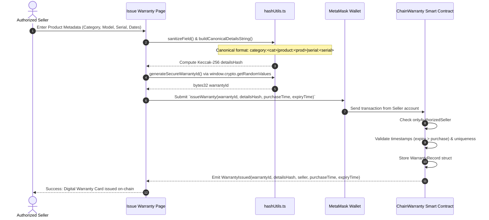
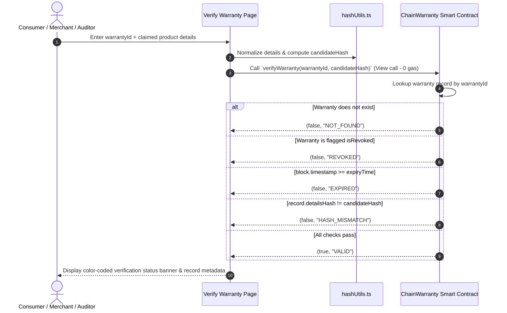
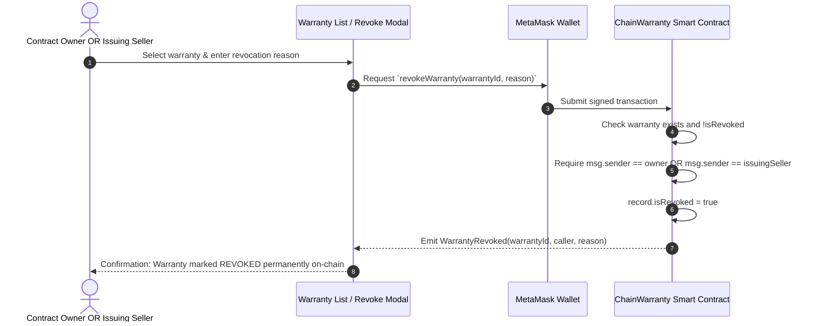

# ChainWarranty Architecture & Workflows

This document details the architectural layout, component interactions, security model, and data flows of the **ChainWarranty** decentralized digital warranty system.

---

## 1. System Architecture

---

## 2. Core Operational Workflows

### A. Seller Authorization Workflow (Owner Only)

---

### B. Warranty Issuance Workflow

---

### C. Warranty Verification Workflow (Public Read)

---

### D. Warranty Revocation Workflow

---

## 3. Privacy & Cryptographic Verification Rationale

1. **Zero Personally Identifiable Information (PII) On-Chain**:
   - Product categories, product names, and serial numbers are never stored in plaintext on the blockchain.
   - Only a cryptographic fingerprint (`detailsHash = keccak256(...)`) is stored.
2. **Canonical Normalization**:
   - Fields are trimmed, lowercased, and joined with explicit prefixes and delimiters (`category:...|product:...|serial:...`).
   - The pipe symbol `|` is prohibited in raw inputs to prevent injection or boundary collisions.
3. **Verification Boundary**:
   - Cryptographic hash verification proves mathematically that the submitted details match the exact parameters recorded at issuance time.
   - It guarantees mathematical consistency and tamper detection; it does not replace physical authentication of physical goods.
